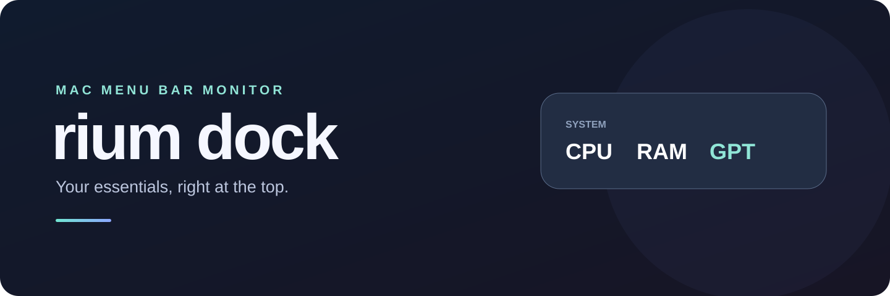
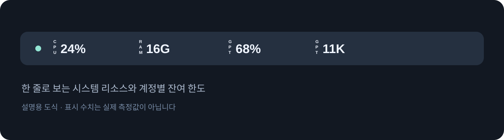

<p align="center"></p>

<h1 align="center">rium dock</h1>
<p align="center"><strong>필요한 숫자를 메뉴 막대에서 바로 확인하세요.</strong><br>Mac의 시스템 리소스와 여러 Codex 계정의 사용량을 위한 간결한 모니터입니다.</p>
<p align="center">  </p>
<p align="center"><a href="#빠르게-시작하기">시작하기</a> · <a href="https://github.com/contentriumkorea/rium-dock/releases/tag/v0.1.0-beta.2">시험판 다운로드</a> · <a href="#사용-모습">사용 모습</a> · <a href="#적용-범위와-제한">제한 사항</a></p>

---

## 빠르게 시작하기

**현재 공개 빌드는 Apple 개발자 서명·공증이 완료되지 않았습니다.** macOS 보안 검사에서 거부되는 것을 확인했으며, 다른 Mac에서 정상 설치·실행할 수 있다고 보장하지 않습니다. 서명·공증이 완료된 일반 사용자용 배포판은 아직 제공하지 않습니다.

[](https://github.com/contentriumkorea/rium-dock/releases/tag/v0.1.0-beta.2)

시험판은 macOS 27.2의 Apple Silicon Mac 한 대에서 확인했습니다. 사용량 조회에는 공식 Codex CLI가 필요합니다. ZIP을 풀면 앱과 제3자 라이선스가 나옵니다. 별도 서버는 필요하지 않습니다.

## 필요한 정보만 간결하게

| 01 · 시스템 | 02 · Codex 계정 | 03 · 내 방식대로 |
| :--- | :--- | :--- |
| **CPU와 RAM** | **여러 계정의 잔여 한도** | **간결한 상단 표시** |
| CPU 사용률과 RAM 추정치를 표시하고 상세 메뉴에서 스왑과 메모리 압력을 확인합니다. | 계정별 한도와 제공되는 크레딧, 초기화 시각 및 연결 상태를 확인합니다. | 계정마다 메뉴 막대에 표시할 이름과 시스템 갱신 주기를 정할 수 있습니다. |

## 사용 모습

<p align="center"></p>

**필요할 때만 상세 메뉴를 펼칩니다.** 위 이미지는 화면 구성을 설명하는 도식이며 수치는 예시입니다.

<details><summary><strong>표시 예시 더 보기</strong></summary>

잔여율이 0%이고 사용 가능한 크레딧이 확인되면 메뉴 막대에 크레딧을 표시합니다. 큰 크레딧 수치는 K 단위로 축약합니다. 제공되지 않은 항목은 조회 불가로 표시합니다.

</details>

## macOS 배포 안내

| 형태 | 안내 |
| :--- | :--- |
| Apple Silicon 시험판 ZIP | [v0.1.0-beta.2 릴리스](https://github.com/contentriumkorea/rium-dock/releases/tag/v0.1.0-beta.2)에서 다운로드할 수 있습니다. Apple 공증이 없어 macOS 보안 검사에서 거부됩니다. |
| 일반 사용자용 빌드 | Apple 개발자 서명·공증과 다른 Mac에서의 설치 검증 후 제공할 예정이며 현재 없습니다. |

## 이렇게 사용하세요

```text
메뉴 막대의 수치 클릭 → 계정 관리 → 계정 추가
계정 선택 → 상단 표시 이름 → 원하는 글자 입력
```

계정의 갱신 시각은 초 단위로 표시됩니다. **지금 새로고침**을 누르면 갱신 중 상태가 보이며, 실패하거나 데이터가 오래되었을 때는 상세 메뉴에서 확인할 수 있습니다.

Codex 계정마다 별도로 로그인합니다. 앱은 공식 CLI를 통해 계정 한도를 조회하며 다른 앱의 로그인 토큰·쿠키를 직접 가져오지 않습니다. 계정 연결 해제는 계정 관리에서 할 수 있습니다.

## 적용 범위와 제한

- 메뉴 막대 아이콘 그룹·숨김 기능은 제공하지 않습니다.
- CPU·RAM은 실제 시스템 데이터이며 RAM은 집계 방식에 따른 추정치입니다.
- 구독 한도 및 제공되는 크레딧은 API 토큰 사용량·요금과 별개입니다.
- 공식 서비스가 제공하지 않는 값은 조회할 수 없습니다. 계정 정보는 해당 Mac의 앱 전용 프로필과 macOS 키체인에 보관됩니다.
- macOS 27.2와 Apple Silicon에서만 실제 실행을 확인했습니다. 다른 macOS 버전과 Intel Mac은 미검증입니다.
- 시험판은 Apple 개발자 서명·공증이 없고 macOS 보안 검사에서 거부됩니다.

<details><summary><strong>상세 안내와 검증 범위</strong></summary>

개발 Mac에서 모니터링 표시, 두 Codex 계정 연결, 초 단위 갱신 시각 및 리소스 메뉴를 확인했습니다. 격리된 시험 계정으로 수동 새로고침과 열린 메뉴의 시각 변경을 확인했습니다. 별도 Mac에서 ZIP을 내려받아 설치·실행·제거하는 경로는 검증하지 않았습니다. 앱 삭제 전 계정 관리에서 연결을 해제하면 해당 계정의 앱 전용 인증과 설정을 삭제할 수 있습니다. 앱만 삭제해도 `~/Library/Application Support/MenuBarWorkspace/` 및 키체인에 저장된 데이터는 자동 삭제되지 않습니다.

</details>

<details><summary><strong>English overview</strong></summary>

rium dock is a preview macOS menu-bar monitor for CPU, memory, and multiple Codex account quotas. It requires the official Codex CLI. The preview is not Developer ID signed or notarized and has been rejected by macOS security assessment. It was tested on one Apple Silicon Mac running macOS 27.2; other systems are unverified.

</details>

---

<p align="center"><strong>Contentrium</strong><br><a href="THIRD_PARTY_NOTICES.md">제3자 라이선스</a> · <a href="https://github.com/contentriumkorea/rium-dock/releases/tag/v0.1.0-beta.2">Preview release</a></p>
<p align="center"><a href="https://contentrium.com/"></a></p>
